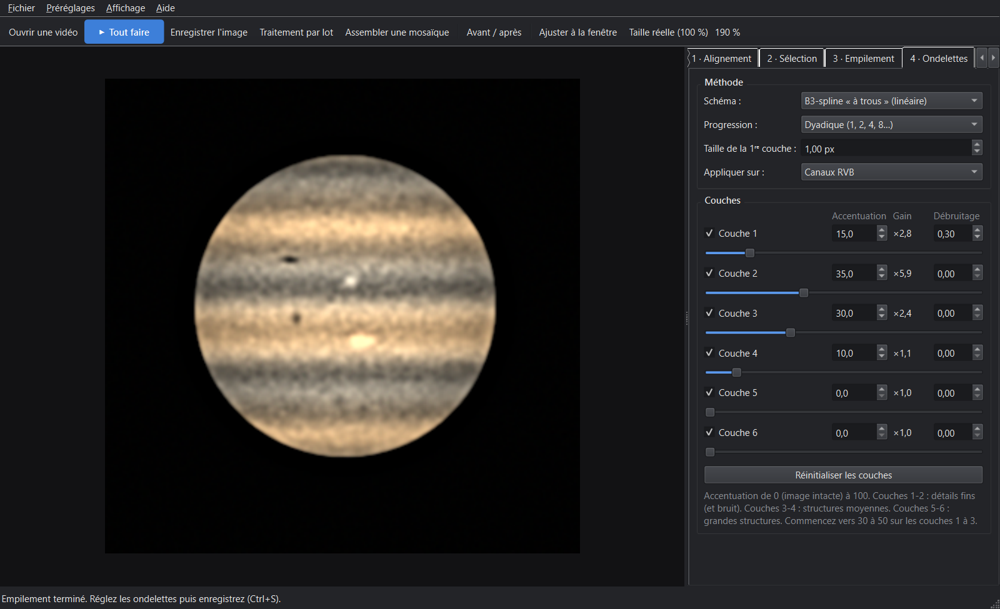
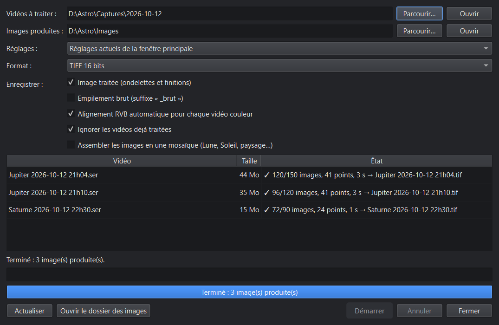
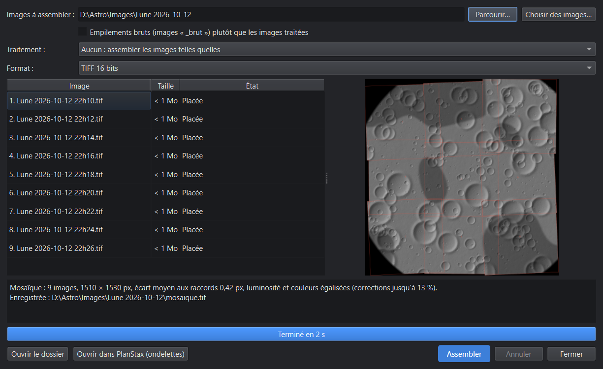

# PlanStax

Empilement « lucky imaging » et traitement par ondelettes pour l'astrophotographie planétaire,
lunaire et solaire, et pour les prises de vue terrestres à travers la turbulence. Programme
moderne pour Windows 10/11 (64 bits), qui reprend le déroulement de travail de RegiStax 6 :
**alignement → sélection → empilement → ondelettes → finitions**.

Interface en **français, anglais et espagnol**.

*English: PlanStax is a free lucky-imaging stacker with 6-layer wavelet sharpening for planetary,
lunar, solar and terrestrial videos (SER, AVI), following the RegiStax 6 workflow. Interface in
French, English and Spanish. Windows 10/11, 64-bit. [Summary in English](#english-summary).*

*Español: PlanStax es un programa libre de apilado «lucky imaging» con ondículas de 6 capas para
vídeos planetarios, lunares, solares y terrestres (SER, AVI), siguiendo el flujo de trabajo de
RegiStax 6. Interfaz en francés, inglés y español. Windows 10/11, 64 bits.
[Resumen en español](#resumen-en-español).*



PlanStax est écrit de zéro, à partir d'algorithmes publics. Il ne contient aucun code de
RegiStax et n'a aucun lien avec RegiStax ni avec son auteur.

## Fonctions

- Alignement global et multipoints, sélection des meilleures images (globale et locale), empilement, agrandissement 1,5×–3×.
- Ondelettes à 6 couches (gain et débruitage par couche), alignement RVB, balance des couleurs, niveaux.
- Orientation : quarts de tour, miroirs et rotation fine de ±90° au dixième de degré.
- Traitement par lot : toutes les vidéos d'un dossier « input » → une image par vidéo dans « output ».
- Mosaïques : les images qui se recouvrent (Lune, Soleil, paysage pris en plusieurs champs) sont
  assemblées automatiquement en une seule, même de plusieurs centaines de mégapixels.
- Import des réglages RegiStax 6 (points d'alignement, sélection).
- Formats : SER, AVI, MP4, FITS, TIFF, PNG ; sortie TIFF/PNG 16 bits, FITS, JPEG.
- Interface et modes d'emploi en français, anglais et espagnol.

## Installation

### Quel fichier télécharger ?

Sur la page **Releases** du projet :

| Fichier | Pour qui |
|---|---|
| **PlanStax-&lt;version&gt;-Windows.zip** | **Windows 10/11.** Décompressez (clic droit → « Extraire tout… »), puis double-cliquez sur `PlanStax.exe`. Rien à installer. |
| **PlanStax-&lt;version&gt;-Mac.zip** | **macOS 12 ou plus récent** (Apple Silicon ou Intel), avec Python 3.13 de python.org. Voir `LISEZ-MOI-Mac.txt` dans l'archive : `PlanStax.command` installe tout au premier lancement. |
| **PlanStax-&lt;version&gt;-Linux.zip** | **Linux 64 bits.** Voir `LISEZ-MOI-Linux.txt` dans l'archive : `./planstax.sh` installe tout au premier lancement. |

Chaque archive contient son mode d'emploi en français (`LISEZ-MOI`), en anglais (`README`) et en
espagnol (`LEAME`).

### Windows (sans Python)

1. Téléchargez `PlanStax-<version>-Windows.zip` depuis la page **Releases** du projet.
2. Clic droit sur le fichier → « Extraire tout… ».
3. Dans le dossier extrait, double-cliquez sur **`PlanStax.exe`**.

Il n'y a rien à installer. Le menu *Aide → Créer un raccourci sur le Bureau* ajoute un raccourci.
Pour désinstaller, supprimez le dossier.

### Mac et Linux (expérimental)

`PlanStax-<version>-Mac.zip` et `PlanStax-<version>-Linux.zip` contiennent les sources et un
script de lancement (`PlanStax.command` ou `planstax.sh`). Au premier lancement, ce script
installe les bibliothèques dans un sous-dossier `.venv`, environ 150 Mo téléchargés une seule
fois. Il faut Python 3.10 ou plus récent : Python 3.13 de python.org sur Mac, et sur Linux
les paquets indiqués dans `LISEZ-MOI-Linux.txt`.

PyPI fournit des bibliothèques toutes prêtes pour macOS 12+ (Apple Silicon et Intel) et pour
Linux x86_64/ARM64, de Python 3.10 à 3.14. Ces versions n'ont pas encore été essayées sur un
vrai Mac ni sur un vrai Linux. Sur Mac, le premier lancement se fait depuis le Terminal, car
Gatekeeper bloque au double-clic les scripts téléchargés : voir `LISEZ-MOI-Mac.txt`.

Pour fabriquer les deux archives : `.venv\Scripts\python.exe packaging\build_source_zips.py`.

### Depuis les sources

Avec [Python 3.12](https://www.python.org/downloads/) installé :

```powershell
py -3.12 -m venv .venv
.venv\Scripts\python.exe -m pip install -e ".[dev]"
.venv\Scripts\python.exe -m planstax
```

## Utilisation en cinq étapes

1. **Ctrl+O** : ouvrir une vidéo SER ou AVI, ou une série d'images (on peut aussi la glisser
   dans la fenêtre).
2. **F5 « Tout faire »** : analyse de la qualité, image de référence, points d'alignement,
   alignement, sélection et empilement.
3. Onglet **Ondelettes** : augmentez l'accentuation des couches 1 à 3 pour faire ressortir les
   détails (30 à 50 pour commencer), et ajoutez un peu de débruitage sur les couches 1-2 si le
   bruit apparaît. L'accentuation va de 0 (image intacte) à 100, avec une plage adaptée à chaque
   couche : un même réglage donne un effet comparable de la couche 1 à la couche 6. Le gain
   réellement appliqué est affiché à côté (×33,3…), et c'est lui qu'enregistrent les préréglages.
4. Onglet **Finitions** : alignement RVB automatique, balance des couleurs, niveaux, orientation.
   La **rotation fine** (±90° au dixième de degré, positif dans le sens horaire) redresse l'image
   finale. L'image est agrandie pour que rien ne soit coupé, et les coins restent noirs.
5. **Ctrl+S** : enregistrer, de préférence en TIFF 16 bits.

Raccourcis : **B** avant/après · **F** ajuster à la fenêtre · **1** 100 % · **P** afficher les points.
Sur l'image de référence, **Ctrl + clic** ajoute un point d'alignement et **Maj + clic** le retire.

## Langue

PlanStax s'affiche en français, en anglais ou en espagnol, selon la langue du système (anglais
pour les autres langues). Pour en changer : menu *Affichage → Langue / Language / Idioma*, puis
redémarrez PlanStax. En ligne de commande : `--lang fr|en|es`, par exemple
`python -m planstax --lang en batch`. La variable d'environnement `PLANSTAX_LANG` a le même
effet.

## Plusieurs vidéos d'un coup (traitement par lot)



1. Déposez les vidéos dans le dossier **`input`** (à côté de `PlanStax.exe`, ou dans le dossier
   du projet).
2. Ouvrez *Fichier → Traitement par lot…* (**Ctrl+L**), puis cliquez sur **Démarrer**.
3. Une image par vidéo est écrite dans le dossier **`output`**, sous le nom de la vidéo
   (`Jupiter 21h04.ser` → `Jupiter 21h04.tif`).

Les réglages appliqués sont ceux de la fenêtre principale, ou un préréglage choisi dans la
fenêtre du lot : réglez d'abord une vidéo à la main, ondelettes comprises.

Options :
- empilement brut en plus (suffixe `_brut`) ;
- format TIFF, PNG, FITS ou JPEG ;
- alignement RVB automatique pour chaque vidéo ;
- les vidéos déjà traitées sont ignorées : on peut en ajouter et relancer.

Les dossiers se changent avec « Parcourir… », et le choix est mémorisé. Une vidéo en erreur
(capture interrompue…) est signalée sans arrêter les autres.

## Mosaïques (Lune, Soleil, paysages)



Quand un sujet ne tient pas dans le champ de la caméra, on le filme en plusieurs vidéos qui se
recouvrent. PlanStax assemble ensuite les images obtenues :

- **dans le traitement par lot**, cochez « Assembler les images en une mosaïque » : à la fin du
  lot, les images sont assemblées dans `output\mosaique.tif` ;
- **pour des images déjà faites**, y compris avec un autre logiciel : *Fichier → Assembler une
  mosaïque…* (**Ctrl+M**), choisissez le dossier ou les images, puis **Assembler**.

Il n'y a rien à régler. Les images sont reconnues et placées automatiquement, quel que soit
l'ordre de prise de vue. La rotation de champ des montures azimutales est compensée. La
luminosité et les couleurs sont égalisées d'une image à l'autre : exposition et balance des
blancs automatiques de l'appareil, transparence du ciel, vignetage de l'optique. Les raccords
sont fondus. Un rapport indique les images placées et celles laissées de côté, avec la raison :
aucun recouvrement trouvé, ou même champ qu'une autre image. Si les images forment plusieurs
ensembles sans lien entre eux, chaque ensemble donne sa propre mosaïque (`mosaique_1.tif`,
`mosaique_2.tif`…).

**Dans le traitement par lot, la mosaïque part des empilements bruts**, enregistrés aussi
(`_brut`). Les ondelettes sont appliquées image par image, mais les finitions (balance des
couleurs, niveaux, gamma, contraste) une seule fois, à la mosaïque entière, après
l'égalisation. Appliqué image par image, un point blanc brûlerait le ciel des images les plus
claires et pas celui de leurs voisines, et laisserait des zones qu'aucune correction ne peut
plus raccorder.

Dans *Assembler une mosaïque…*, la liste **Traitement** fait de même pour des empilements
bruts déjà enregistrés : ondelettes et finitions des réglages actuels ou d'un préréglage. On
peut ainsi régler une image à la main, puis refaire toute la mosaïque sans réempiler les
vidéos.

L'orientation des finitions (quarts de tour, miroirs, rotation fine) s'applique aussi à la
mosaïque. Les images sont alors placées directement dans le cadre tourné, sans second
rééchantillonnage.

Conseils :
- prévoyez environ **25 % de recouvrement** entre champs voisins ;
- traitez toutes les vidéos avec les mêmes réglages : c'est le cas dans un même lot.

Au foyer d'un télescope, chaque champ ne couvre qu'une fraction de degré : les images se
raccordent par simple décalage et rotation, sans les corrections de perspective des panoramas
au grand-angle. Celles-ci ne sont pas prises en charge.

## Correspondance avec RegiStax 6

| RegiStax 6 | PlanStax |
|---|---|
| Set alignpoints / Estimate (Dist, Low/High intensity, Matrix edge) | Onglet 1 : Espacement, Luminosité min./max., Marge au bord |
| Alignbox size | Taille des boîtes |
| Align | Bouton « Aligner » (alignement global + multipoints) |
| Limit (meilleures images) | Onglet 2 : pourcentage, nombre ou qualité minimale, avec la courbe de qualité |
| Stack | Onglet 3 : Empiler (+ sélection locale par point, agrandissement 1,5×–3×) |
| Wavelets (6 couches, linéaire/gaussien, dyadique/linéaire) | Onglet 4 : même principe, avec un gain et un débruitage par couche |
| Functions (RGB align, RGB balance, gamma…) | Onglet 5 : Finitions |
| Macros / Do All | Bouton « Tout faire » et traitement par lot |

**Importer ses réglages RegiStax** : menu *Préréglages → Importer depuis RegiStax 6…*. Les
fichiers `estimate-*`, `limit-*`, `wavelet-*` et `macro-*.ini` sont lus, y compris les copies plus
récentes que Windows range dans `AppData\Local\VirtualStore`. Sont repris : points
d'alignement, sélection, type d'ondelettes. Les gains des ondelettes ne le sont pas : la formule
interne des curseurs de RegiStax n'est pas publique et aucune conversion simple ne donne un
résultat juste. Ils restent au neutre, et les positions d'origine sont affichées pour les régler
à l'œil.

## Ligne de commande

```powershell
.venv\Scripts\python.exe -m planstax batch                       # dossiers input → output
.venv\Scripts\python.exe -m planstax batch D:\Captures D:\Images -p MonReglage --raw
.venv\Scripts\python.exe -m planstax batch D:\Lune D:\Lune\images -p MonReglage --mosaic
.venv\Scripts\python.exe -m planstax mosaic D:\Lune\images --brut -p MonReglage -o D:\Lune\lune.tif
.venv\Scripts\python.exe -m planstax stack "D:\Captures\Jupiter\*.ser" -p MonReglage -o D:\Resultats --wavelets
.venv\Scripts\python.exe -m planstax wavelets empilement.tif -p MonReglage
.venv\Scripts\python.exe -m planstax presets --import-registax "C:\Program Files (x86)\RegiStax 6"
.venv\Scripts\python.exe -m planstax demo essai.ser --color
.venv\Scripts\python.exe -m planstax demo champs-lune --mosaic   # 9 champs pour essayer la mosaïque
.venv\Scripts\python.exe -m planstax --lang en batch             # messages en anglais
```

Dans la version portable : `PlanStax.exe cli batch …` (sans console : seul le code de retour
indique le résultat).

Options utiles de `stack` : `--percent 50` (images gardées), `--scale 1.5` (agrandissement),
`--bayer RGGB` (forcer la matrice), `-f png|tif|fits|jpg`, `-b 8|16|32`. `mosaic` prend un
dossier (avec `--brut` pour ses empilements bruts) ou une liste d'images ; `-p` y applique les
ondelettes et finitions d'un préréglage, comme le traitement par lot.

## Formats

- **Entrée** : SER (8/16 bits, mono, Bayer, RVB, avec horodatage ; vidéos interrompues acceptées),
  AVI et autres vidéos lues par FFmpeg (8 bits), séries FITS / TIFF (y compris compressés LZW) /
  PNG / JPEG / BMP.
- **Sortie** : TIFF 16 bits, PNG 16 bits, FITS 16 bits ou 32 bits flottant, JPEG.
- Les chemins avec accents (« Éclipse été ») sont gérés.

## Où sont les réglages

`%APPDATA%\PlanStax\` sous Windows, `~/Library/Application Support/PlanStax` sur Mac,
`~/.config/PlanStax` sous Linux :
- `presets\*.json` : les préréglages, lisibles et modifiables ;
- `last.json` : les derniers réglages, restaurés au démarrage ;
- `interface.ini` : la taille de la fenêtre, les derniers dossiers, le thème et la langue.

Rien n'est écrit dans `Program Files` ni dans le registre.

## Choix techniques

- **64 bits et multicœur** : plus de limite à 2–4 Go, et les vidéos de plusieurs Go sont lues
  sans être chargées entièrement en mémoire.
- **Images inutilisables écartées d'office** (onglet 1, case cochée par défaut) : images presque
  noires (champ vide), images aux couleurs anormales et, pour une planète, images où elle touche
  le bord du champ (suivi, vent). Une image arrivée de la caméra décalée d'une ligne a sa matrice
  de couleurs lue de travers : le vert et le bleu s'échangent, et le motif en labyrinthe qui en
  résulte passerait pour du détail. Elle se repère à sa couleur, très différente de celle des
  images voisines. Ces images ne servent ni à la référence ni à l'empilement. Le pourcentage gardé (onglet 2) se
  compte sur les images restantes. Si la planète touche le bord dans la plupart des images
  (cadrage serré), ces images sont gardées.
- **Alignement local précis au sous-pixel** : corrélation, puis affinage de type Lucas-Kanade.
  Le long d'un bord de disque, où rien ne permet de mesurer un glissement, le point reprend le
  décalage global au lieu d'inventer un mouvement.
- **Vidéo qui dérive dans le champ** (suivi imparfait) : chaque image est recalée sur la
  référence, et une partie de la zone recalée tombe alors au-delà de son bord. Elle n'y compte
  pas : dans la référence comme dans l'empilement, une image ne compte que là où elle couvre
  vraiment le champ. Les bords de l'image finale reposent sur moins d'images, mais rien n'y est
  inventé (pas de reflet du limbe ou de la planète dans le ciel).
- **Surfaces et paysages** (Lune, Soleil, prises de vue terrestres) : l'alignement global se
  fait sur toute l'image et non sur son centre. Il s'appuie sur les zones qui restent fixes d'une
  image à l'autre, repérées pendant la construction de la référence (la colline plutôt que la
  mer qui bouge). Il n'est pas trompé par la trame de compression des vidéos MP4/AVI.
- **Sélection locale** (onglet 3) : chaque zone peut garder ses propres meilleures images.
  À 100 %, les mêmes images servent partout, comme dans RegiStax.
- **Mosaïques** : points caractéristiques SIFT appariés entre toutes les images, vérifiés par
  RANSAC, puis placement de toutes les images à la fois par moindres carrés. Une paire en
  désaccord avec les autres (motif répétitif apparié au mauvais endroit) est écartée. La
  luminosité est égalisée, canal par canal, par une carte de gain douce par image :
  exposition de l'image, vignetage commun à toutes (mesuré dans les recouvrements, corrigé
  jusqu'aux bords de la mosaïque) et écarts résiduels. Les échantillons en désaccord (bateaux,
  vagues) comptent moins. Les écarts admis restent bornés, pour que de petites différences
  systématiques entre voisines ne s'additionnent pas d'une rangée à l'autre. Le fondu se fait en deux bandes :
  la luminosité sur toute la largeur du recouvrement, les détails sur un raccord étroit. La
  mosaïque est calculée par bandes horizontales et écrite en TIFF tuilé : 56 images de
  2872 × 2872 px donnent une mosaïque de 370 Mpx en une minute et demie, avec environ 1 Go de
  mémoire.
- **Affichage** : adapté à la mise à l'échelle de Windows (125 %, 150 %…), avec des thèmes
  sombre, clair et « nuit » rouge qui préserve la vision nocturne.

## Fabriquer la version portable

```powershell
.venv\Scripts\python.exe packaging\build_portable.py
powershell -ExecutionPolicy Bypass -File packaging\test_portable.ps1
```

Le premier script produit `dist\PlanStax-<version>-Windows.zip` (environ 90 Mo). Le second le
vérifie dans les conditions d'un utilisateur : archive marquée comme téléchargée, décompressée
avec l'outil de Windows dans un dossier accentué, empilement complet, traitement par lot,
mosaïque et démarrage de l'interface.

**Pourquoi Windows ne bloque pas ce `.exe`.** `PlanStax.exe` est l'interpréteur Python officiel
(`pythonw.exe`), simplement renommé. Il garde donc sa signature numérique de la Python Software
Foundation, que le Contrôle intelligent des applications de Windows 11 et SmartScreen acceptent.
Au démarrage, Python exécute `runtime\site-packages\sitecustomize.py`, qui lance PlanStax. Un
`.exe` compilé spécialement (PyInstaller…) ne serait pas signé et serait bloqué.

Les modules compilés des bibliothèques (NumPy, OpenCV…) ne sont pas signés : Windows les juge sur
leur réputation, c'est-à-dire leur diffusion dans le monde. NumPy 2.5.4, trop récent, a été
bloqué en octobre 2026 ; le projet reste donc sur NumPy 2.2.x, très répandu (voir
`pyproject.toml`). Avant de passer à une version plus récente d'une bibliothèque, refaites le test
portable sur un PC où cette protection est active.

Le script de fabrication ne garde de Qt que le nécessaire (205 → 50 Mo). Il vérifie que chaque
bibliothèque DLL trouve ses dépendances, Visual C++ compris, pour fonctionner sur un PC neuf.

## Développement

```powershell
.venv\Scripts\python.exe -m pytest        # 80 tests : formats, alignement, empilement, mosaïques, lot, interface, langues, archives
```

Organisation du code :
- `planstax\io` : lecture et écriture SER, FITS, images et vidéos ;
- `planstax\core` : qualité, alignement global et local, empilement, ondelettes, finitions, mosaïques ;
- `planstax\gui` : l'interface Qt ;
- `planstax\batch.py`, `planstax\cli.py` : traitement par lot et ligne de commande ;
- `planstax\synth.py` : génération de vidéos et de champs lunaires artificiels pour les tests ;
- `planstax\i18n.py`, `planstax\locales\catalog.py` : les langues. Les textes sont écrits en
  français dans le code, entourés de `tr()`, et le catalogue donne leur traduction anglaise et
  espagnole. `packaging\extract_texts.py --missing` liste ceux qui ne sont pas encore traduits ;
- `packaging\` : fabrication et test de la version portable.

## Limites connues

- AVI : lu en 8 bits via FFmpeg. Pour du 12/16 bits, capturez en SER.
- Pas encore de « deringing » (atténuation des halos sur le limbe) ni de drizzle au sens strict :
  l'agrandissement est un rééchantillonnage pendant l'empilement.
- Les gains d'ondelettes de RegiStax ne sont pas transposables (voir plus haut).

## English summary

PlanStax stacks planetary, lunar, solar and terrestrial videos (SER, AVI, MP4) the "lucky imaging"
way and sharpens the result with 6-layer wavelets, following the RegiStax 6 workflow. It is
written from scratch and has no link with RegiStax nor its author.

- **Windows 10/11**: download `PlanStax-<version>-Windows.zip` from the **Releases** page,
  right-click → "Extract All…", then double-click `PlanStax.exe`. Nothing to install.
- **Mac and Linux** (experimental): see `README-Mac.txt` or `README-Linux.txt` in the archive;
  the launcher script installs the libraries on the first start.
- **Use**: Ctrl+O open a video · F5 "Do all" (alignment, selection, stacking) · Wavelets tab
  (sharpening 30 to 50 on layers 1 to 3 to begin with) · Finishing tab (RGB alignment, colour
  balance, levels, orientation with a fine rotation of ±90° by tenths of a degree) · Ctrl+S save.
- **Batch processing** (Ctrl+L): every video of the `input` folder gives one image in `output`.
  **Mosaics** (Ctrl+M, or a tick box in the batch): overlapping fields are assembled
  automatically, with brightness and colours evened out.
- **Language**: following the system; View menu → "Langue / Language / Idioma", or
  `--lang en` on the command line.

## Resumen en español

PlanStax apila vídeos planetarios, lunares, solares y terrestres (SER, AVI, MP4) con la técnica
«lucky imaging» y realza el resultado con ondículas de 6 capas, siguiendo el flujo de trabajo
de RegiStax 6. Está escrito desde cero y no tiene ninguna relación con RegiStax ni con su autor.

- **Windows 10/11**: descargue `PlanStax-<version>-Windows.zip` desde la página **Releases**,
  clic derecho → «Extraer todo…» y doble clic en `PlanStax.exe`. No hay nada que instalar.
- **Mac y Linux** (experimental): véase `LEAME-Mac.txt` o `LEAME-Linux.txt` en el archivo;
  el script de inicio instala las bibliotecas la primera vez.
- **Uso**: Ctrl+O abrir un vídeo · F5 «Hacer todo» (alineación, selección, apilado) · pestaña
  Ondículas (realce de 30 a 50 en las capas 1 a 3 para empezar) · pestaña Acabado (alineación
  RGB, balance de color, niveles, orientación con rotación fina de ±90° por décimas de grado)
  · Ctrl+S guardar.
- **Procesamiento por lotes** (Ctrl+L): cada vídeo de la carpeta `input` da una imagen en
  `output`. **Mosaicos** (Ctrl+M, o una casilla en el lote): los campos que se solapan se montan
  automáticamente, con el brillo y los colores igualados.
- **Idioma**: según el del sistema; menú Ver → «Langue / Language / Idioma», o `--lang es` en
  la línea de comandos.

## Licence

MIT © 2026 Photographifi. La version portable inclut Python, NumPy, OpenCV, Qt (PySide6) et
tifffile, chacun sous sa propre licence (fichiers fournis dans `runtime`).
