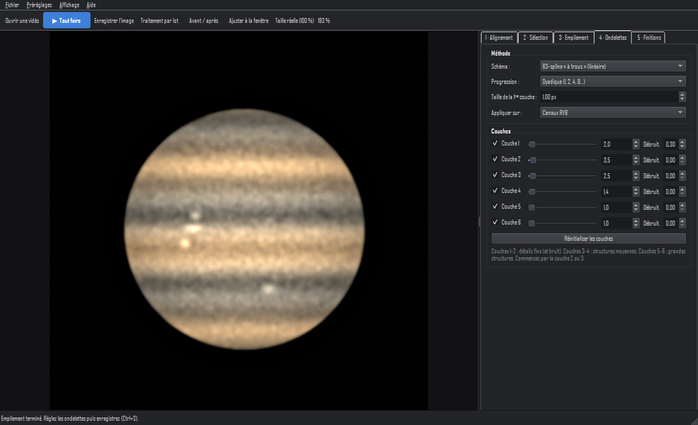
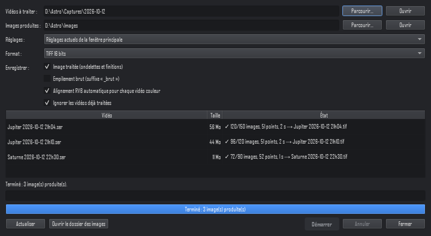

# PlanStax

Empilement « lucky imaging » et traitement par ondelettes pour l'astrophotographie planétaire,
lunaire et solaire, et pour les prises de vue terrestres à travers la turbulence. Programme
moderne pour Windows 10/11 (64 bits), qui reprend le déroulement de travail de RegiStax 6 :
**alignement → sélection → empilement → ondelettes → finitions**.

*English: PlanStax is a free lucky-imaging stacker with 6-layer wavelet sharpening for planetary,
lunar, solar and terrestrial videos (SER, AVI), following the RegiStax 6 workflow. Interface in
French. Windows 10/11, 64-bit.*



PlanStax est écrit de zéro, à partir d'algorithmes publics. Il ne contient aucun code de
RegiStax et n'a aucun lien avec RegiStax ni avec son auteur.

## Installation
Première version publique de **PlanStax** : empilement « lucky imaging » et ondelettes pour l'imagerie planétaire, lunaire, solaire et terrestre (vidéos SER, AVI, MP4), sur le modèle du déroulement de travail de RegiStax 6.

## Quel fichier télécharger ?

| Fichier | Pour qui |
|---|---|
| **PlanStax-0.3.0-Windows.zip** | **Windows 10/11 : le choix conseillé.** Décompressez (clic droit → « Extraire tout… »), puis double-cliquez sur `PlanStax.exe`. Rien à installer. |
| PlanStax-autonome.exe | Windows, version en un seul fichier (expérimentale). Plus pratique, mais non signée : Windows peut la bloquer ou afficher « Windows a protégé votre ordinateur » (→ « Informations complémentaires » → « Exécuter quand même »). En cas de blocage, utilisez le .zip. |

|**PlanStax-0.3.0-Linux.zip** | **Linux 64 bits** . Voir `LISEZ-MOI-Linux.txt` dans l'archive : `./planstax.sh` installe tout au premier lancement. |

## Fonctions

- Alignement global et multipoints, sélection des meilleures images (globale et locale), empilement, agrandissement 1,5×–3×.
- Ondelettes à 6 couches (gain et débruitage par couche), alignement RVB, balance des couleurs, niveaux.
- Traitement par lot : toutes les vidéos d'un dossier « input » → une image par vidéo dans « output ».
- Import des réglages RegiStax 6 (points d'alignement, sélection).
- Formats : SER, AVI, MP4, FITS, TIFF, PNG ; sortie TIFF/PNG 16 bits, FITS, JPEG.

## Empreintes SHA-256

```
72cf50f9e5406019ad3b2356fd5ff0a2912e731afd94d47fa9683ae4fdf9f5f4  PlanStax-0.3.0-Windows.zip
bb0ff5d4fa073ed9293e067fc1ba0afaa63df25eb798b792ebfcd29ca3eaa616  PlanStax-0.3.0-Linux.zip
9aa948bf959496e7ce49ea9d830743c070f24dfdf6532a6c3f8bdbb61dc928f3  PlanStax-autonome.exe
```

PlanStax est écrit de zéro et n'a aucun lien avec RegiStax ni avec son auteur. Licence MIT.
### Pour l'utiliser (sans Python)

1. Téléchargez `PlanStax-<version>-Windows.zip` depuis la page **Releases** du projet.
2. Clic droit sur le fichier → « Extraire tout… ».
3. Dans le dossier extrait, double-cliquez sur **`PlanStax.exe`**.

Il n'y a rien à installer. Le menu *Aide → Créer un raccourci sur le Bureau* ajoute un raccourci.
Pour désinstaller, supprimez le dossier.

### Linux (expérimental)

`PlanStax-<version>-Linux.zip` contient les sources et un script `planstax.sh`. Au premier
lancement, ce script installe les bibliothèques dans un sous-dossier `.venv`, environ 150 Mo
téléchargés une seule fois. Il faut Python 3.10 ou plus récent ; les paquets système à
installer selon la distribution sont indiqués dans `LISEZ-MOI-Linux.txt`. PyPI fournit des
bibliothèques toutes prêtes pour x86_64 et ARM64, de Python 3.10 à 3.14. Cette version n'a pas
encore été essayée sur un vrai Linux. Pour fabriquer l'archive :
`.venv\Scripts\python.exe packaging\build_linux_zip.py`.

### Depuis les sources

Avec [Python 3.12](https://www.python.org/downloads/) installé :

```powershell
py -3.12 -m venv .venv
.venv\Scripts\python.exe -m pip install -e ".[dev]"
.venv\Scripts\python.exe -m planstax
```

## Utilisation en cinq étapes

1. **Ctrl+O** : ouvrir une vidéo SER ou AVI, ou une série d'images (on peut aussi la glisser
   dans la fenêtre).
2. **F5 « Tout faire »** : analyse de la qualité, image de référence, points d'alignement,
   alignement, sélection et empilement.
3. Onglet **Ondelettes** : augmentez le gain des couches 1 à 3 pour faire ressortir les détails,
   et ajoutez un peu de débruitage sur les couches 1-2 si le bruit apparaît.
4. Onglet **Finitions** : alignement RVB automatique, balance des couleurs, niveaux, orientation.
5. **Ctrl+S** : enregistrer, de préférence en TIFF 16 bits.

Raccourcis : **B** avant/après · **F** ajuster à la fenêtre · **1** 100 % · **P** afficher les points.
Sur l'image de référence, **Ctrl + clic** ajoute un point d'alignement et **Maj + clic** le retire.

## Plusieurs vidéos d'un coup (traitement par lot)



1. Déposez les vidéos dans le dossier **`input`** (à côté de `PlanStax.exe`, ou dans le dossier
   du projet).
2. Ouvrez *Fichier → Traitement par lot…* (**Ctrl+L**), puis cliquez sur **Démarrer**.
3. Une image par vidéo est écrite dans le dossier **`output`**, sous le nom de la vidéo
   (`Jupiter 21h04.ser` → `Jupiter 21h04.tif`).

Les réglages appliqués sont ceux de la fenêtre principale, ou un préréglage choisi dans la
fenêtre du lot : réglez d'abord une vidéo à la main, ondelettes comprises.

Options :
- empilement brut en plus (suffixe `_brut`) ;
- format TIFF, PNG, FITS ou JPEG ;
- alignement RVB automatique pour chaque vidéo ;
- les vidéos déjà traitées sont ignorées : on peut en ajouter et relancer.

Les dossiers se changent avec « Parcourir… », et le choix est mémorisé. Une vidéo en erreur
(capture interrompue…) est signalée sans arrêter les autres.

## Correspondance avec RegiStax 6

| RegiStax 6 | PlanStax |
|---|---|
| Set alignpoints / Estimate (Dist, Low/High intensity, Matrix edge) | Onglet 1 : Espacement, Luminosité min./max., Marge au bord |
| Alignbox size | Taille des boîtes |
| Align | Bouton « Aligner » (alignement global + multipoints) |
| Limit (meilleures images) | Onglet 2 : pourcentage, nombre ou qualité minimale, avec la courbe de qualité |
| Stack | Onglet 3 : Empiler (+ sélection locale par point, agrandissement 1,5×–3×) |
| Wavelets (6 couches, linéaire/gaussien, dyadique/linéaire) | Onglet 4 : même principe, avec un gain et un débruitage par couche |
| Functions (RGB align, RGB balance, gamma…) | Onglet 5 : Finitions |
| Macros / Do All | Bouton « Tout faire » et traitement par lot |

**Importer ses réglages RegiStax** : menu *Préréglages → Importer depuis RegiStax 6…*. Les
fichiers `estimate-*`, `limit-*`, `wavelet-*` et `macro-*.ini` sont lus, y compris les copies plus
récentes que Windows range dans `AppData\Local\VirtualStore`. Sont repris : points
d'alignement, sélection, type d'ondelettes. Les gains des ondelettes ne le sont pas : la formule
interne des curseurs de RegiStax n'est pas publique et aucune conversion simple ne donne un
résultat juste. Ils restent au neutre, et les positions d'origine sont affichées pour les régler
à l'œil.

## Ligne de commande

```powershell
.venv\Scripts\python.exe -m planstax batch                       # dossiers input → output
.venv\Scripts\python.exe -m planstax batch D:\Captures D:\Images -p MonReglage --raw
.venv\Scripts\python.exe -m planstax stack "D:\Captures\Jupiter\*.ser" -p MonReglage -o D:\Resultats --wavelets
.venv\Scripts\python.exe -m planstax wavelets empilement.tif -p MonReglage
.venv\Scripts\python.exe -m planstax presets --import-registax "C:\Program Files (x86)\RegiStax 6"
.venv\Scripts\python.exe -m planstax demo essai.ser --color
```

Dans la version portable : `PlanStax.exe cli batch …` (sans console : seul le code de retour
indique le résultat).

Options utiles de `stack` : `--percent 50` (images gardées), `--scale 1.5` (agrandissement),
`--bayer RGGB` (forcer la matrice), `-f png|tif|fits|jpg`, `-b 8|16|32`.

## Formats

- **Entrée** : SER (8/16 bits, mono, Bayer, RVB, avec horodatage ; vidéos interrompues acceptées),
  AVI et autres vidéos lues par FFmpeg (8 bits), séries FITS / TIFF (y compris compressés LZW) /
  PNG / JPEG / BMP.
- **Sortie** : TIFF 16 bits, PNG 16 bits, FITS 16 bits ou 32 bits flottant, JPEG.
- Les chemins avec accents (« Éclipse été ») sont gérés.

## Où sont les réglages

`%APPDATA%\PlanStax\` :
- `presets\*.json` : les préréglages, lisibles et modifiables ;
- `last.json` : les derniers réglages, restaurés au démarrage ;
- `interface.ini` : la taille de la fenêtre, les derniers dossiers et le thème.

Rien n'est écrit dans `Program Files` ni dans le registre.

## Choix techniques

- **64 bits et multicœur** : plus de limite à 2–4 Go, et les vidéos de plusieurs Go sont lues
  sans être chargées entièrement en mémoire.
- **Alignement local précis au sous-pixel** : corrélation, puis affinage de type Lucas-Kanade.
  Le long d'un bord de disque, où rien ne permet de mesurer un glissement, le point reprend le
  décalage global au lieu d'inventer un mouvement.
- **Surfaces et paysages** (Lune, Soleil, prises de vue terrestres) : l'alignement global se
  fait sur toute l'image et non sur son centre. Il s'appuie sur les zones qui restent fixes d'une
  image à l'autre, repérées pendant la construction de la référence (la colline plutôt que la
  mer qui bouge). Il n'est pas trompé par la trame de compression des vidéos MP4/AVI.
- **Sélection locale** (onglet 3) : chaque zone peut garder ses propres meilleures images.
  À 100 %, les mêmes images servent partout, comme dans RegiStax.
- **Affichage** : adapté à la mise à l'échelle de Windows (125 %, 150 %…), avec des thèmes
  sombre, clair et « nuit » rouge qui préserve la vision nocturne.

## Fabriquer la version portable

```powershell
.venv\Scripts\python.exe packaging\build_portable.py
powershell -ExecutionPolicy Bypass -File packaging\test_portable.ps1
```

Le premier script produit `dist\PlanStax-<version>-Windows.zip` (environ 90 Mo). Le second le
vérifie dans les conditions d'un utilisateur : archive marquée comme téléchargée, décompressée
avec l'outil de Windows dans un dossier accentué, empilement complet, traitement par lot et
démarrage de l'interface.

**Pourquoi Windows ne bloque pas ce `.exe`.** `PlanStax.exe` est l'interpréteur Python officiel
(`pythonw.exe`), simplement renommé. Il garde donc sa signature numérique de la Python Software
Foundation, que le Contrôle intelligent des applications de Windows 11 et SmartScreen acceptent.
Au démarrage, Python exécute `runtime\site-packages\sitecustomize.py`, qui lance PlanStax. Un
`.exe` compilé spécialement (PyInstaller…) ne serait pas signé et serait bloqué.

Les modules compilés des bibliothèques (NumPy, OpenCV…) ne sont pas signés : Windows les juge sur
leur réputation, c'est-à-dire leur diffusion dans le monde. NumPy 2.5.4, trop récent, a été
bloqué en octobre 2026 ; le projet reste donc sur NumPy 2.2.x, très répandu (voir
`pyproject.toml`). Avant de passer à une version plus récente d'une bibliothèque, refaites le test
portable sur un PC où cette protection est active.

Le script de fabrication ne garde de Qt que le nécessaire (205 → 50 Mo). Il vérifie que chaque
bibliothèque DLL trouve ses dépendances, Visual C++ compris, pour fonctionner sur un PC neuf.

## Développement

```powershell
.venv\Scripts\python.exe -m pytest        # 46 tests : formats, alignement, empilement, lot, interface, archives
```

Organisation du code :
- `planstax\io` : lecture et écriture SER, FITS, images et vidéos ;
- `planstax\core` : qualité, alignement global et local, empilement, ondelettes, finitions ;
- `planstax\gui` : l'interface Qt ;
- `planstax\batch.py`, `planstax\cli.py` : traitement par lot et ligne de commande ;
- `planstax\synth.py` : génération de vidéos artificielles pour les tests ;
- `packaging\` : fabrication et test de la version portable.

## Limites connues

- AVI : lu en 8 bits via FFmpeg. Pour du 12/16 bits, capturez en SER.
- Pas encore de « deringing » (atténuation des halos sur le limbe) ni de drizzle au sens strict :
  l'agrandissement est un rééchantillonnage pendant l'empilement.
- Les gains d'ondelettes de RegiStax ne sont pas transposables (voir plus haut).

## Licence

MIT © 2026 Photographifi. La version portable inclut Python, NumPy, OpenCV, Qt (PySide6) et
tifffile, chacun sous sa propre licence (fichiers fournis dans `runtime`).
